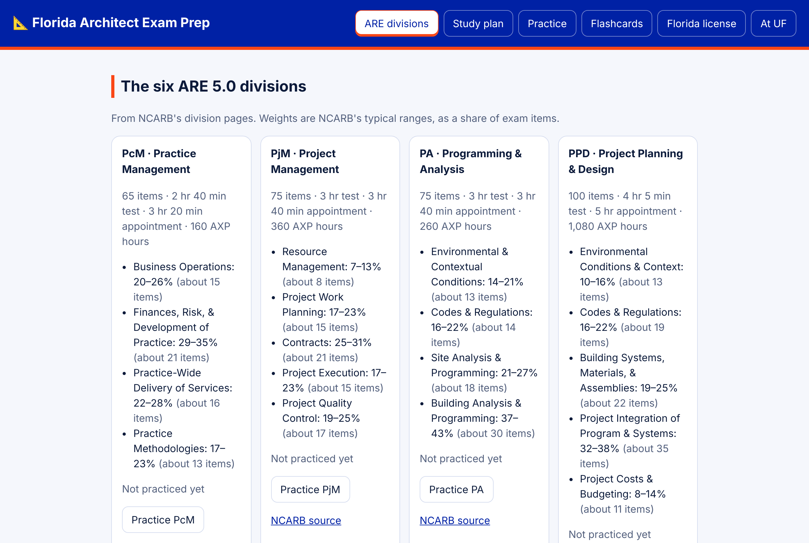
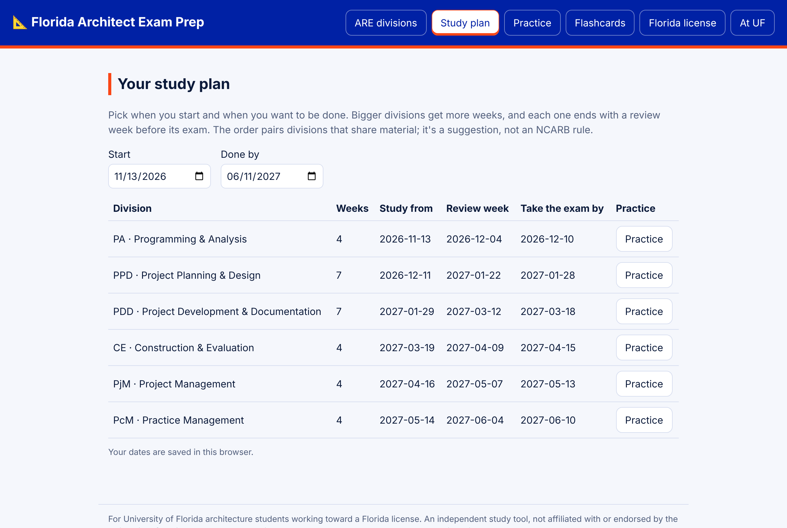
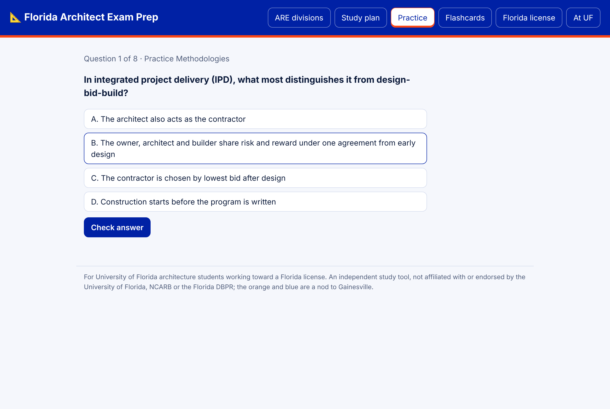
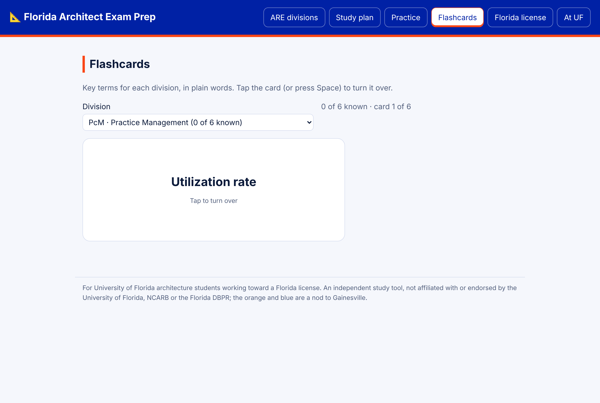
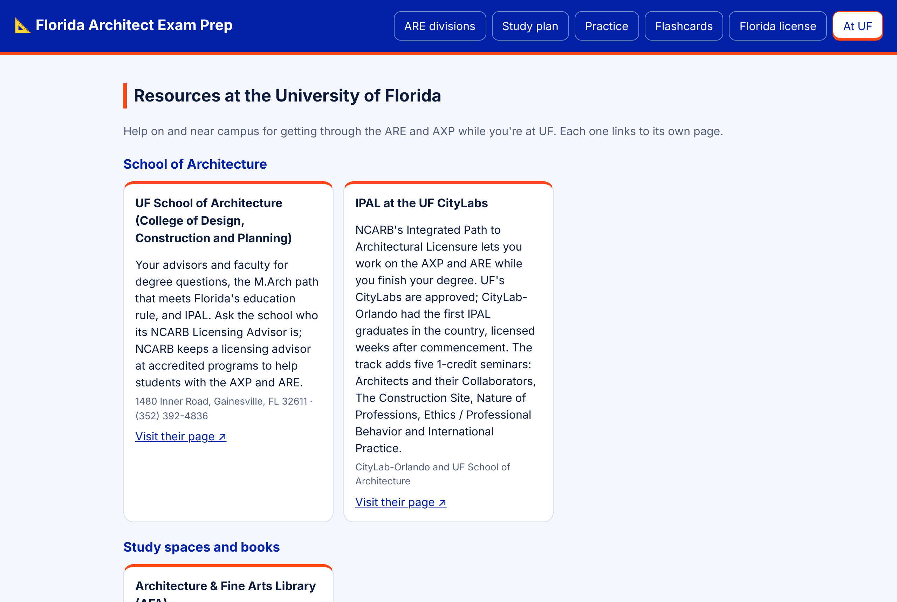
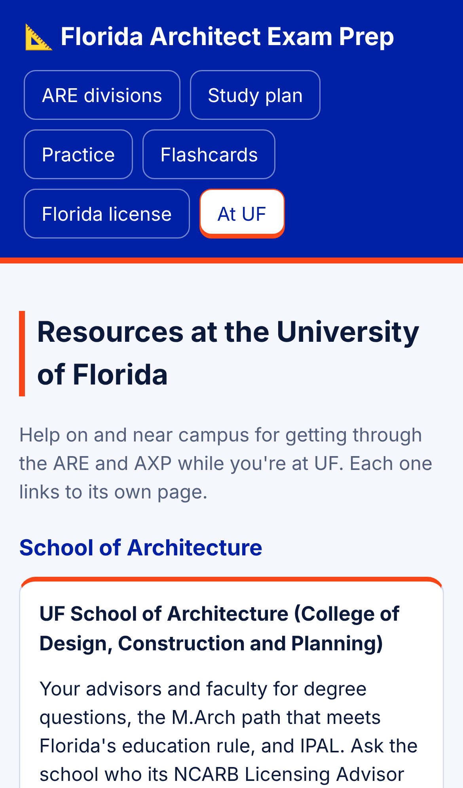

# 📐 Florida Architect Exam Prep

A study web app for the Architect Registration Examination (ARE 5.0) and the path to an architect license in Florida, written for University of Florida architecture students and recent graduates who want to pass every division on the first try.

**Live app:** https://theoyanvno.github.io/florida-architect-exam-prep/

## Screenshots

| ARE divisions | Study plan |
|---|---|
|  |  |
| **Practice** | **Flashcards** |
|  |  |
| **At UF** | **On a phone** |
|  |  |

## What it covers

- The six ARE 5.0 divisions with NCARB's item counts, test times and section weights
- The AXP experience hours by area
- A Florida licensing checklist from the Florida Board of Architecture and Interior Design
- A study plan that spreads the six divisions between your start and goal dates, saved in the browser
- 48 original practice questions (8 per division), one division at a time or a 20-question mixed test, with an optional timer at the exam's pace, explanations, a score by NCARB section and your best score saved
- Answer choices shuffled every session, a review of every question you missed, and a Missed list to practice until you get them right
- An At UF page of campus help: the School of Architecture, IPAL at the UF CityLabs, the Architecture & Fine Arts Library and its databases, UF AIAS, NOMAS and Alpha Rho Chi, the Career Connections Center for AXP jobs, and AIA Florida's ARE scholarship and PrepARE pack
- 36 flashcards of key terms (6 per division) with Got it and Again, saved in the browser

Every fact links to its source (NCARB, the Florida DBPR board pages and the University of Florida School of Architecture). Practice questions are written for this app; nothing is copied from NCARB or prep companies.

## Run it

```
npm install
npm start      # http://localhost:8000
npm test
```

## Built with

React, JavaScript, esbuild, Node's test runner

## Credits

Built with help from AI coding tools; every feature is reviewed and tested before it ships. Not affiliated with or endorsed by NCARB, the Florida DBPR or the University of Florida. The orange-and-blue colors are a nod to Gainesville; no UF logos or marks are used.

## License

MIT. See [LICENSE](LICENSE).
